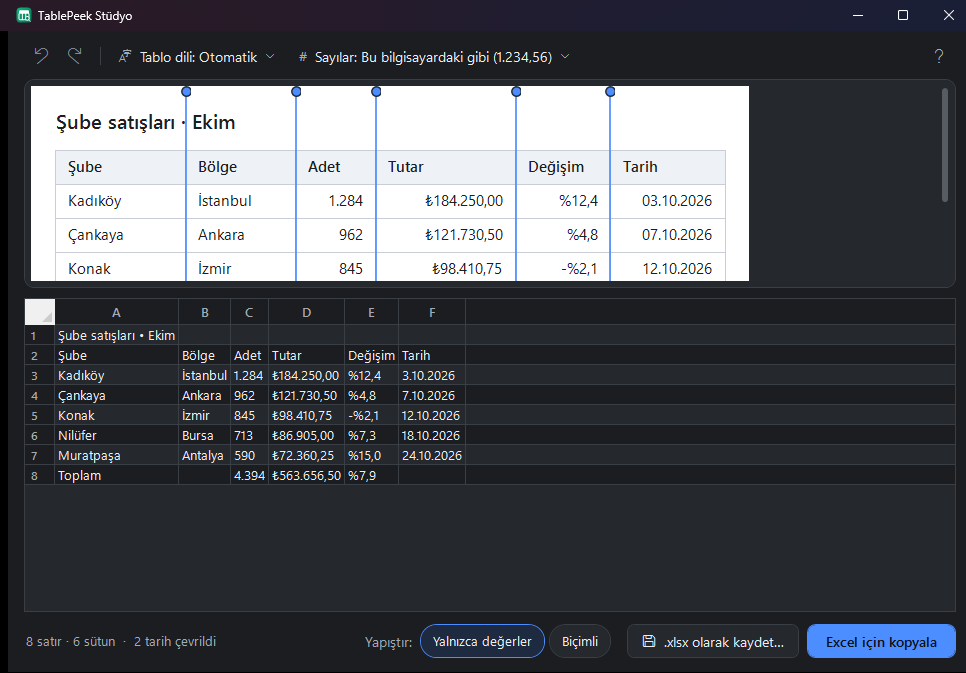
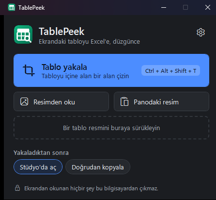
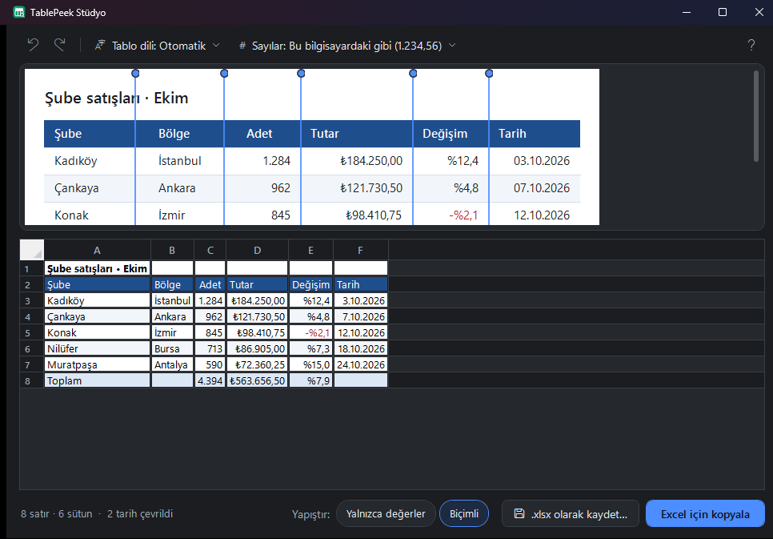

# TablePeek

Ekrandaki bir tabloyu okuyup Excel'e **düzgünce** yapıştıran küçük bir Windows aracı.

A small Windows tool that reads a table on your screen and pastes it into Excel **cleanly**.

**📖 [Türkçe kılavuz](docs/README.tr.md) · [English guide](docs/README.en.md)** · [Changelog](CHANGELOG.md) · [Gizlilik / Privacy](PRIVACY.md) · [Hata bildir / Report a problem](https://github.com/umitkrkmz/tablepeek/issues/new/choose)

<!-- Store ID known after publishing: switch the link to https://apps.microsoft.com/detail/<store-id>?referrer=appbadge&mode=direct -->

<table align="center">
  <tr>
    <td valign="top"></td>
    <td valign="top"></td>
  </tr>
</table>

Görüntülerdeki tablolar uydurmadır. · The tables in the pictures are made up.

## Türkçe

Bir web sayfasında, PDF'te, sunumda ya da kopyalanamayan bir uygulamada gördüğünüz tabloyu satır satır yazmanıza gerek yok.

- **Tek kısayol:** `Ctrl + Alt + Shift + T`'ye basın, tablonun çevresine bir kutu çizin. Ya da bir resim dosyasından, panodaki resimden veya pencereye sürüklenen görselden okuyun.
- **Bu bilgisayarda okunur:** Windows'un kendi yazı tanımasıyla; sütunlar, satırlar, sayılar, ₺ / $ / %, tarihler bulunur. E-tablo görüntülerinde satır numaraları ve sütun harfleri ayıklanır.
- **Stüdyo'da düzeltin:** sütun sınırlarını görüntünün üstünde sürükleyin; bir hücreyi yeniden okuyun, birleştirin, bölün, satır ve sütun ekleyin. Her adım geri alınabilir.
- **Excel'e gerçek değerlerle:** para, yüzde, sayı ve tarihler metin olarak değil, değer olarak gider. Yalnızca değerler ya da biçimli (dolgu, renk, kalınlık, kenarlık, birleştirilmiş hücreler); ya da filtreli bir Excel tablosuyla **.xlsx** olarak kaydedin.
- **Dürüst:** yazı tanımanın sık hatalarını (0/O, 1/I, kayıp nokta ve virgül, ₺ ve % işaretleri) düzeltir; emin olamadığı bir hücreyi tahmin etmez, okunduğu gibi bırakır.
- **Küçük ve gizli:** internete hiç bağlanmaz; hesap, reklam ve telemetri yok. Bildirim alanında bekler. Türkçe ve İngilizce, açık ve koyu tema.

TablePeek [Microsoft Store](https://apps.microsoft.com/search?query=TablePeek)'da, tek seferlik ödemeyle. Kısayollar, Stüdyo, ayarlar ve yazı tanıma dil paketleri: **[Türkçe kılavuz](docs/README.tr.md)**.

## English

No need to type in a table you see on a web page, in a PDF, in a presentation or in an app that won't let you copy.

- **One shortcut:** press `Ctrl + Alt + Shift + T` and draw a box around the table. Or read from an image file, an image on the clipboard or a picture dragged onto the window.
- **Read on this PC:** with the text recognition built into Windows; it finds columns, rows, numbers, currency and % signs, and dates. In spreadsheet pictures, row numbers and column letters are left out.
- **Fix it in the Studio:** drag column borders on the picture; read a cell again, merge, split, insert rows and columns. Every step can be undone.
- **Into Excel as real values:** money, percentages, numbers and dates arrive as values, not text. Values only or formatted (fill, colour, bold, borders, merged cells); or save as **.xlsx** with a filtered Excel table.
- **Honest:** it fixes common recognition mistakes (0/O, 1/I, lost dots and commas, currency and % signs); a cell it can't be sure of is never guessed, it is left as read.
- **Small and private:** never goes online; no account, ads or telemetry. Waits in the notification area. Turkish and English, light and dark theme.

TablePeek is on the [Microsoft Store](https://apps.microsoft.com/search?query=TablePeek), a one-time purchase. Shortcuts, the Studio, settings and text recognition language packs: **[English guide](docs/README.en.md)**.

## Bu repo / This repo

TablePeek kapalı kaynaklıdır ve bağımsız bir geliştiricinin işidir. Bu repo yalnızca belgeleri, gizlilik politikasını, değişiklik günlüğünü ve hata bildirimlerini barındırır.

TablePeek is closed source, made by an independent developer. This repo holds only the documentation, privacy policy, changelog and issue tracker.

## Lisans / License

Bu repodaki belgeler ve görseller [CC BY 4.0](LICENSE) lisanslıdır. **TablePeek adı, logosu ve uygulamanın kendisi bu lisansa dahil değildir.**

The documents and pictures in this repo are licensed under [CC BY 4.0](LICENSE). **The TablePeek name, logo and the app itself are not covered by this license.**
