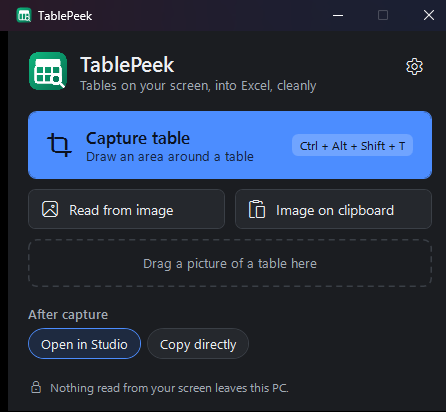
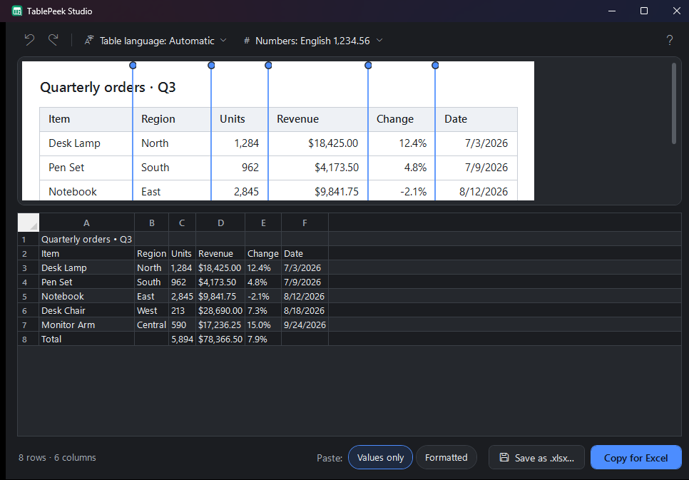
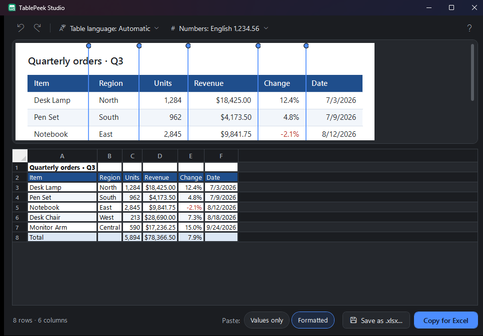
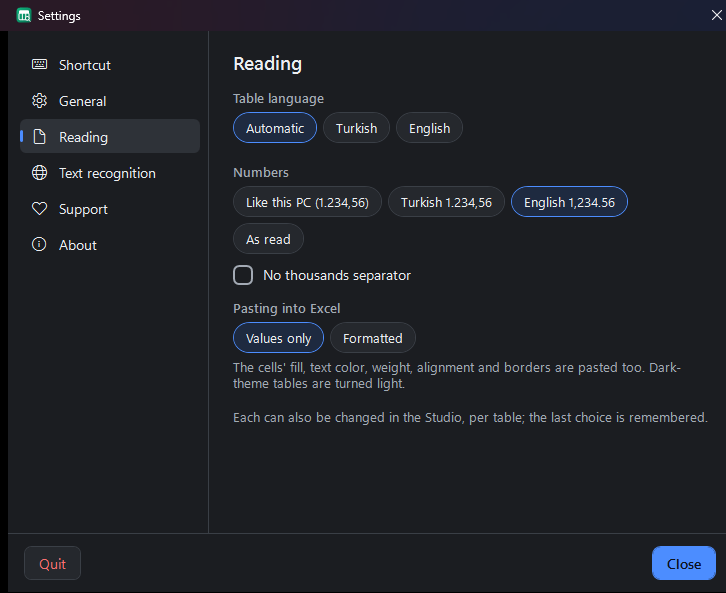
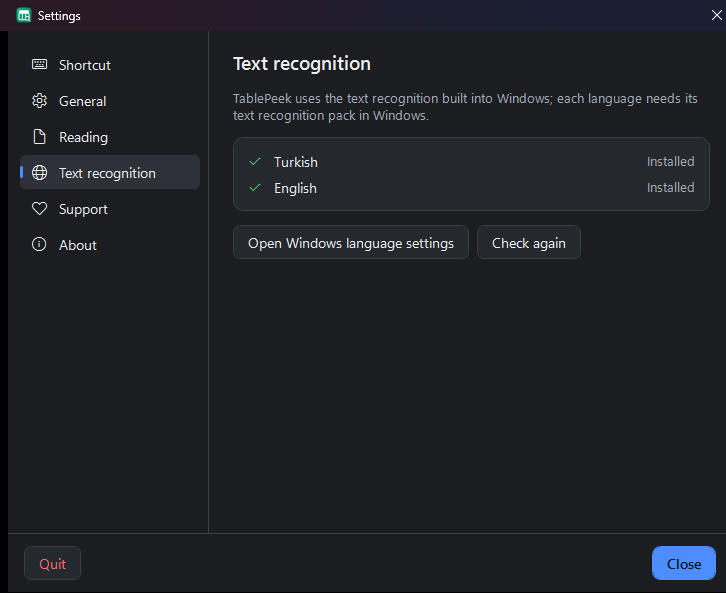

# TablePeek — English guide

[← Home](../README.md) · [Türkçe kılavuz](README.tr.md)

TablePeek reads a table you see on your screen and pastes it into Excel cleanly. Reading is done with the text recognition built into Windows, **on this PC**; TablePeek never connects to the internet.

---

## Contents

1. [Install and requirements](#1-install-and-requirements)
2. [Quick start](#2-quick-start)
3. [Ways to read a table](#3-ways-to-read-a-table)
4. [The Studio](#4-the-studio)
5. [Table language](#5-table-language)
6. [Numbers and dates](#6-numbers-and-dates)
7. [Into Excel](#7-into-excel)
8. [Copy-directly mode](#8-copy-directly-mode)
9. [Settings](#9-settings)
10. [Text recognition language packs](#10-text-recognition-language-packs)
11. [Shortcuts](#11-shortcuts)
12. [Tips and limits](#12-tips-and-limits)
13. [Support](#13-support)
14. [Privacy and reporting a problem](#14-privacy-and-reporting-a-problem)

---

## 1. Install and requirements

- Installed from the **[Microsoft Store](https://apps.microsoft.com/detail/9nv50jzqdsht)**, which also keeps it up to date. A one-time purchase; no subscription.
- Windows 10 version 2004 or later, Windows 11 (x64 and ARM64).
- At least one Windows **text recognition (OCR) language pack**. Windows usually has the one for its display language; for Turkish and English tables, having both is best (see [section 10](#10-text-recognition-language-packs)).
- No internet connection needed.

## 2. Quick start

1. Open the table on your screen (web page, PDF, presentation, screenshot…).
2. Press `Ctrl + Alt + Shift + T` or click **Capture table** in the main window.
3. The screen freezes; draw a box around the table (`Esc` cancels).
4. The **Studio** opens: the picture you selected on top, the table that was read below. Fix it if needed.
5. Press **Copy for Excel** and paste in Excel (`Ctrl + V`).

When you close the main window, TablePeek keeps running in the **notification area**. A left click on its icon starts a new capture; its right-click menu has **Open TablePeek**, **Settings**, what happens after a capture, and **Quit**.

## 3. Ways to read a table

| Way | How |
|---|---|
| From the screen | The shortcut, **Capture table** in the main window, or a left click on the notification area icon. Works across several monitors. |
| From an image file | **Read from image** in the main window (PNG, JPG, BMP, GIF, TIFF). |
| From the clipboard | **Image on clipboard** in the main window, or `Ctrl + V` while it's open. A copied image file works too. |
| Drag and drop | Drop a picture or an image file on the main window. |

When you start a capture from the main window it steps out of the way, and comes back if the Studio doesn't open (cancelled, or copy-directly mode).

## 4. The Studio

**Toolbar:** undo / redo, the **Table language** and **Numbers** menus, and **?** on the right (help and a note on text recognition).

**Column borders (the blue lines over the picture):**
- Drag to move.
- Double-click to add a border.
- Right-click to remove one.
The table is rebuilt from the words that were read after every change.

**The table (below):**
- Click a cell and type to edit it.
- `Delete`: removes the selected rows or clears cells.
- Right-click a column header: delete the column.
- Right-click a cell:
  - **Read this cell again** (the cell is read on its own, several ways; if more than one result comes up, you pick)
  - **Bold**
  - **Merge cells** / **Unmerge cells** (merged cells show as one in the Studio too; a formatted paste and .xlsx bring them to Excel as centred merged cells)
  - **Split** (in two at the last space)
  - **Insert row above / below**, **Insert column left / right**
- `Ctrl + Z` undoes, `Ctrl + Y` redoes.

In pictures of spreadsheets (Excel, Google Sheets…) the row numbers and column letters are left out of the table; a note appears at the top, and `Ctrl + Z` brings them back.

**Bottom row:** row and column count and how many numbers/dates were converted; **Paste: Values only / Formatted**; **Save as .xlsx…**; **Copy for Excel**.

## 5. Table language

**Automatic**, **Turkish** or **English**. Automatic picks right for most tables (an English-looking table is read in English). Changing it reads **the same picture** again in that language; `Ctrl + Z` goes back to the previous reading. The choice is remembered and used for later captures too. A language with no text recognition pack in Windows can't be chosen.

## 6. Numbers and dates

The **Numbers** menu sets how numbers and dates are pasted; the table shows them that way too:

| Option | Number | Date |
|---|---|---|
| Like this PC (default) | Windows' format | Windows' short date |
| Turkish | 1.234,56 | 3.10.2026 |
| English | 1,234.56 | 10/3/2026 |
| As read | Unchanged | Unchanged |

**No thousands separator** writes 1234.56. Each column's source format is worked out from its own numbers; IP addresses, version numbers, codes and numbers that look like dates are not converted. Dates whose day and month can't be told apart (only 1/2/2014 and the like) stay as read; dates in another format are pasted as text so Excel can't misread them.

## 7. Into Excel

**Copy for Excel:**
- **Values only** (default): just the cells' contents.
- **Formatted:** the fill, text colour, bold, alignment, borders, column widths and merged cells come too. Dark-theme tables are turned light. The Studio's table shows the look that will be pasted.

Either way, **money** ($, €, £, ₺, USD, TL…), **percentages**, **numbers** and **dates** arrive in Excel as real values, not text: ready to sum, sort and filter. Leading zeros and long codes stay intact.

**Save as .xlsx…:** writes an Excel workbook where you choose, then opens it: an Excel table with filter and sort buttons on the header row, a frozen header row, real values; with "Formatted", the look and merged cells too.

## 8. Copy-directly mode

With **After capture: Copy directly** (main window or Settings → General) the Studio doesn't open: you select the area, the table is on the clipboard, and a notification appears. Click it to open the same table in the Studio. The number format and paste choice are your last ones from the Studio.

## 9. Settings

The gear button in the main window, or the notification area menu → **Settings**.

| Page | What's there |
|---|---|
| Shortcut | The capture shortcut (Ctrl + Alt + Shift + T, Win + Ctrl + T, Win + Alt + T, Ctrl + Alt + T, or off). A warning appears if another app already uses it. |
| General | After capture (Studio / copy directly), the app language (like Windows / Türkçe / English; takes effect after a restart), start with Windows. |
| Reading | Default table language, numbers, thousands separator, pasting into Excel. Each can also be changed in the Studio, per table. |
| Text recognition | Whether the Turkish and English recognition packs are installed, other installed languages, steps to install. |
| Support | Optional thank-yous and supporter extras (see [section 13](#13-support)). |
| About | Version, privacy policy, third-party notices, reporting a problem. |

> `Ctrl + Alt + T` isn't the default: on a Turkish Q keyboard `AltGr + T` types ₺, and that shortcut would swallow it.

## 10. Text recognition language packs

TablePeek uses the text recognition built into Windows; each language needs its **optical character recognition** pack in Windows. **Settings → Text recognition** shows which are installed.

To install a missing one:
1. Press **Open Windows language settings** (or Settings → Time & language → Language & region).
2. If the language isn't listed, add it with **Add a language**.
3. **⋯** next to the language → **Language options** → **Optical character recognition** → **Download**.
4. In TablePeek, press **Check again**.

## 11. Shortcuts

| Where | Shortcut | What it does |
|---|---|---|
| Anywhere | `Ctrl + Alt + Shift + T` (can be changed) | Capture a table |
| While selecting | `Esc` | Cancel |
| Main window | `Ctrl + V` | Read the image on the clipboard |
| Studio | `Ctrl + Z` / `Ctrl + Y` | Undo / redo |
| Studio | `Delete` | Delete rows / clear cells |

## 12. Tips and limits

- **Text recognition can make mistakes.** TablePeek tries to fix mix-ups like 0 and O, 1 and I, and lost dots and commas; a cell it can't be sure of is **never guessed**, it is left as read. Glance over the table before copying; try right-click → **Read this cell again** on a wrong cell, or fix it by hand.
- **Small text:** zoom the table in on screen (`Ctrl + +`) before capturing; it reads noticeably better.
- **Columns split wrongly:** drag, add or remove the blue lines over the picture.
- **Select just the table:** a menu or filter panel next to it can get mixed in (side panels in spreadsheet pictures are left out by themselves).
- **Handwriting and very decorative fonts** don't read well.
- For **Turkish tables**, having the Turkish recognition pack installed matters for ₺ and Turkish letters.

## 13. Support

I build TablePeek on my own. When you buy it, all of it is yours; the optional thank-yous in **Settings → Support** turn no feature on or off. A thank-you unlocks **colour themes** for the Studio, **notification area icon** choices and a small **supporter mark** in About. Bought once, yours for good; it unlocks on another PC with the same Microsoft account too. The purchase is handled by the Microsoft Store's own dialog.

## 14. Privacy and reporting a problem

- No account, no ads, no telemetry; TablePeek never connects to the internet. Screen captures are processed in memory only. Details: [Privacy policy](../PRIVACY.md).
- For a bug or a suggestion: [report it on GitHub](https://github.com/umitkrkmz/tablepeek/issues/new/choose). For a table that reads wrong, attach an example picture **without personal data** if you can.
- Release notes: [CHANGELOG](../CHANGELOG.md).
