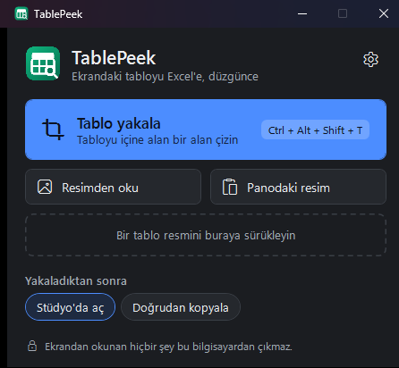
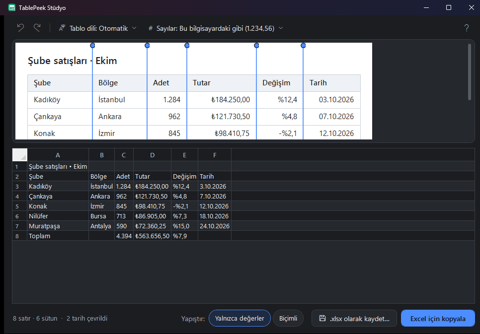
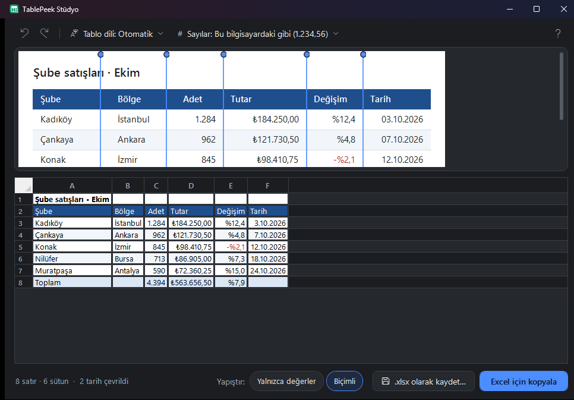
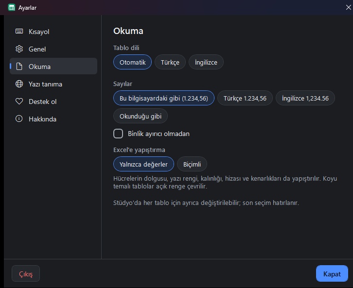
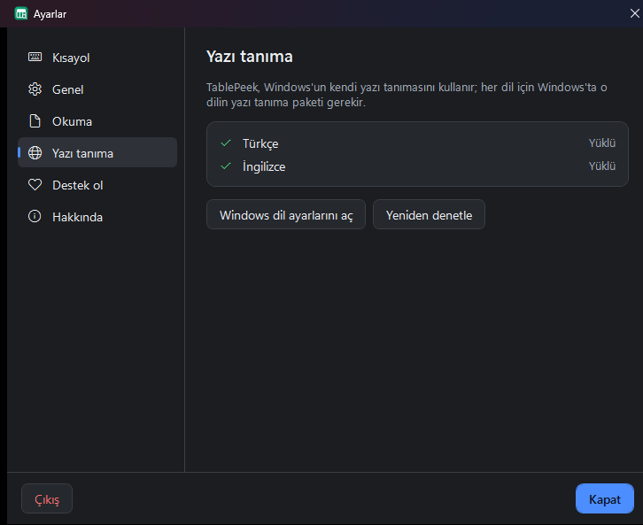

# TablePeek — Türkçe kılavuz

[← Ana sayfa](../README.md) · [English guide](README.en.md)

TablePeek, ekranınızda gördüğünüz bir tabloyu okur ve Excel'e düzgünce yapıştırır. Okuma, Windows'un kendi yazı tanımasıyla **bu bilgisayarda** yapılır; TablePeek internete hiç bağlanmaz.

---

## İçindekiler

1. [Kurulum ve gereksinimler](#1-kurulum-ve-gereksinimler)
2. [Hızlı başlangıç](#2-hızlı-başlangıç)
3. [Tabloyu okumanın yolları](#3-tabloyu-okumanın-yolları)
4. [Stüdyo](#4-stüdyo)
5. [Tablo dili](#5-tablo-dili)
6. [Sayılar ve tarihler](#6-sayılar-ve-tarihler)
7. [Excel'e aktarma](#7-excele-aktarma)
8. [Doğrudan kopyalama modu](#8-doğrudan-kopyalama-modu)
9. [Ayarlar](#9-ayarlar)
10. [Yazı tanıma dil paketleri](#10-yazı-tanıma-dil-paketleri)
11. [Kısayollar](#11-kısayollar)
12. [İpuçları ve sınırlar](#12-ipuçları-ve-sınırlar)
13. [Destek ol](#13-destek-ol)
14. [Gizlilik ve sorun bildirme](#14-gizlilik-ve-sorun-bildirme)

---

## 1. Kurulum ve gereksinimler

- **[Microsoft Store](https://apps.microsoft.com/detail/9nv50jzqdsht)**'dan kurulur, güncellemeleri Store'dan kendiliğinden gelir. Tek seferlik ödeme; abonelik yok.
- Windows 10 sürüm 2004 ya da sonrası, Windows 11 (x64 ve ARM64).
- Windows'ta en az bir **yazı tanıma (OCR) dil paketi**. Windows genellikle kendi görüntüleme dilininkini kurar; Türkçe ve İngilizce tablolar için ikisinin de kurulu olması en iyisidir (bkz. [bölüm 10](#10-yazı-tanıma-dil-paketleri)).
- İnternet bağlantısı gerekmez.

## 2. Hızlı başlangıç

1. Tabloyu ekranda açın (web sayfası, PDF, sunum, ekran görüntüsü…).
2. `Ctrl + Alt + Shift + T`'ye basın ya da ana penceredeki **Tablo yakala**'ya tıklayın.
3. Ekran donar; tablonun çevresine bir kutu çizin (`Esc`: iptal).
4. **Stüdyo** açılır: üstte seçtiğiniz görüntü, altta okunan tablo. Gerekirse düzeltin.
5. **Excel için kopyala**'ya basın ve Excel'de yapıştırın (`Ctrl + V`).

Ana pencereyi kapattığınızda TablePeek **bildirim alanında** çalışmaya devam eder. Simgeye sol tıklamak yeni bir yakalama başlatır; sağ tık menüsünde **TablePeek'i aç**, **Ayarlar**, yakaladıktan sonra ne olacağı ve **Çıkış** vardır.

## 3. Tabloyu okumanın yolları

| Yol | Nasıl |
|---|---|
| Ekrandan | Kısayol, ana penceredeki **Tablo yakala** ya da bildirim alanı simgesine sol tık. Birden çok monitörde de çalışır. |
| Resim dosyasından | Ana pencerede **Resimden oku** (PNG, JPG, BMP, GIF, TIFF). |
| Panodaki resimden | Ana pencerede **Panodaki resim** ya da pencere açıkken `Ctrl + V`. Kopyalanmış bir resim dosyası da olur. |
| Sürükle-bırak | Bir resmi ya da resim dosyasını ana pencereye bırakın. |

Ana pencereden yakalama başlatınca pencere yolunuzdan çekilir; Stüdyo açılmazsa (iptal, doğrudan kopyalama) geri gelir.

## 4. Stüdyo

**Üst araç çubuğu:** geri al / yinele, **Tablo dili** ve **Sayılar** menüleri, sağda **?** (yardım ve yazı tanıma uyarısı).

**Sütun sınırları (görüntünün üstündeki mavi çizgiler):**
- Sürükleyerek taşıyın.
- Çift tıklayarak yeni bir sınır ekleyin.
- Sağ tıklayarak silin.
Tablo her değişiklikte okunan kelimelerden yeniden kurulur.

**Tablo (alt kısım):**
- Hücreye tıklayıp yazarak düzenleyin.
- `Delete`: seçili satırları siler ya da hücreleri boşaltır.
- Sütun başlığına sağ tık: sütunu sil.
- Hücreye sağ tık:
  - **Bu hücreyi yeniden oku** (hücre tek başına, farklı yollarla okunur; birden çok sonuç çıkarsa seçersiniz)
  - **Kalın**
  - **Hücreleri birleştir** / **Birleştirmeyi kaldır** (birleştirilmiş hücreler Stüdyo'da da tek hücre görünür; biçimli yapıştırmada ve .xlsx'te Excel'e ortalanmış birleştirilmiş hücre olarak gider)
  - **Böl** (son boşluktan ikiye)
  - **Üstüne / Altına satır ekle**, **Soluna / Sağına sütun ekle**
- `Ctrl + Z` geri alır, `Ctrl + Y` yineler.

E-tablo (Excel, Google E-Tablolar…) görüntülerinde satır numaraları ve sütun harfleri tablodan çıkarılır; üstte bir not belirir, `Ctrl + Z` geri getirir.

**Alt satır:** satır ve sütun sayısı ile kaç sayı/tarih çevrildiği; **Yapıştır: Yalnızca değerler / Biçimli**; **.xlsx olarak kaydet…**; **Excel için kopyala**.

## 5. Tablo dili

**Otomatik**, **Türkçe** ya da **İngilizce**. Otomatik çoğu tabloda doğru seçer (İngilizce görünen bir tablo İngilizce okunur). Değiştirince **aynı görüntü** o dilde yeniden okunur; `Ctrl + Z` önceki okumaya döner. Seçim hatırlanır ve sonraki yakalamalarda da kullanılır. Windows'ta yazı tanıma paketi kurulu olmayan dil seçilemez.

## 6. Sayılar ve tarihler

**Sayılar** menüsü, sayıların ve tarihlerin nasıl yapıştırılacağını belirler; tabloda da öyle görünür:

| Seçenek | Sayı | Tarih |
|---|---|---|
| Bu bilgisayardaki gibi (varsayılan) | Windows'un biçimi | Windows'un kısa tarihi |
| Türkçe | 1.234,56 | 3.10.2026 |
| İngilizce | 1,234.56 | 10/3/2026 |
| Okunduğu gibi | Dokunulmaz | Dokunulmaz |

**Binlik ayırıcı olmadan** seçeneği 1234,56 yazar. Her sütunun kaynak biçimi kendi sayılarından anlaşılır; IP adresleri, sürüm numaraları, kodlar ve tarihe benzeyen numaralar çevrilmez. Gün mü ay mı olduğu anlaşılamayan tarihler (yalnızca 1/2/2014 gibi) okunduğu gibi kalır; başka biçimdeki tarihler Excel yanlış okumasın diye metin olarak yapıştırılır.

## 7. Excel'e aktarma

**Excel için kopyala:**
- **Yalnızca değerler** (varsayılan): yalnızca hücrelerin içeriği.
- **Biçimli:** dolgu rengi, yazı rengi, kalınlık, hizalama, kenarlıklar, sütun genişlikleri ve birleştirilmiş hücreler de gelir. Koyu temalı tablolar açık renge çevrilir. Stüdyo'daki tablo yapıştırılacak görünümü gösterir.

Her iki durumda da **para** (₺, $, €, £, TL, USD…), **yüzde**, **sayı** ve **tarihler** Excel'e metin olarak değil gerçek değer olarak gider: hemen toplayabilir, sıralayabilir, filtreleyebilirsiniz. Başında sıfır olan numaralar ve uzun kodlar bozulmaz.

**.xlsx olarak kaydet…:** seçtiğiniz yere bir Excel çalışma kitabı yazar ve açar: başlık satırında filtre ve sıralama düğmeli bir Excel tablosu, sabit başlık satırı, gerçek değerler; "Biçimli" seçiliyse görünüm ve birleştirilmiş hücreler de.

## 8. Doğrudan kopyalama modu

Ana pencerede ya da Ayarlar → Genel'de **Yakaladıktan sonra: Doğrudan kopyala** seçilirse Stüdyo açılmaz: alanı seçersiniz, tablo panoya gelir ve bir bildirim çıkar. Bildirime tıklarsanız aynı tablo Stüdyo'da açılır. Sayı biçimi ve yapıştırma seçimi Stüdyo'daki son seçimlerinizdir.

## 9. Ayarlar

Ana penceredeki dişli düğmesi ya da bildirim alanı menüsü → **Ayarlar**.

| Sayfa | İçerik |
|---|---|
| Kısayol | Tablo yakalama kısayolu (Ctrl + Alt + Shift + T, Win + Ctrl + T, Win + Alt + T, Ctrl + Alt + T ya da kapalı). Kısayol başka bir uygulamada kullanılıyorsa uyarı çıkar. |
| Genel | Yakaladıktan sonra (Stüdyo / doğrudan kopyala), uygulamanın dili (Windows'a göre / Türkçe / English; yeniden başlayınca geçerli), Windows açılınca başlat. |
| Okuma | Varsayılan tablo dili, sayılar, binlik ayırıcı, Excel'e yapıştırma. Stüdyo'da her tablo için ayrıca değiştirilebilir. |
| Yazı tanıma | Türkçe ve İngilizce yazı tanıma paketlerinin kurulu olup olmadığı, diğer kurulu diller, kurma adımları. |
| Destek ol | İsteğe bağlı teşekkür ve destekçi ekstraları (bkz. [bölüm 13](#13-destek-ol)). |
| Hakkında | Sürüm, gizlilik politikası, üçüncü taraf bildirimleri, hata bildirme. |

> `Ctrl + Alt + T` varsayılan değildir: Türkçe Q klavyede `AltGr + T` ₺ yazar, bu kısayol onu yutar.

## 10. Yazı tanıma dil paketleri

TablePeek, Windows'un kendi yazı tanımasını kullanır; her dil için Windows'ta o dilin **optik karakter tanıma** paketi gerekir. **Ayarlar → Yazı tanıma** hangilerinin kurulu olduğunu gösterir.

Eksik bir dili kurmak için:
1. **Windows dil ayarlarını aç** düğmesine basın (ya da Ayarlar → Zaman ve dil → Dil ve bölge).
2. Dil listede yoksa **Dil ekle** ile ekleyin.
3. Dilin yanındaki **⋯** → **Dil seçenekleri** → **Optik karakter tanıma** → **İndir**.
4. TablePeek'te **Yeniden denetle**.

## 11. Kısayollar

| Nerede | Kısayol | Ne yapar |
|---|---|---|
| Her yerde | `Ctrl + Alt + Shift + T` (değiştirilebilir) | Tablo yakala |
| Alan seçerken | `Esc` | İptal |
| Ana pencere | `Ctrl + V` | Panodaki resmi oku |
| Stüdyo | `Ctrl + Z` / `Ctrl + Y` | Geri al / yinele |
| Stüdyo | `Delete` | Satırları sil / hücreleri boşalt |

## 12. İpuçları ve sınırlar

- **Yazı tanıma hata yapabilir.** 0 ile O, 1 ile I gibi karışıklıkları ve kayıp nokta/virgülleri TablePeek düzeltmeye çalışır; emin olamadığı bir hücreyi **tahmin etmez**, okunduğu gibi bırakır. Kopyalamadan önce tabloya bir göz atın; yanlış bir hücreyi sağ tık → **Bu hücreyi yeniden oku** ile deneyin ya da elle düzeltin.
- **Küçük yazı:** tabloyu ekranda yakınlaştırıp (`Ctrl + +`) öyle yakalamak okumayı belirgin şekilde iyileştirir.
- **Sütunlar yanlış bölündüyse:** görüntüdeki mavi çizgileri sürükleyin, ekleyin ya da silin.
- **Yalnızca tabloyu seçin:** yanındaki menü, filtre paneli gibi şeyler tabloya karışabilir (e-tablo görüntülerinde yan paneller kendiliğinden ayıklanır).
- **El yazısı ve çok süslü yazı tipleri** iyi okunmaz.
- **Türkçe tablolar** için Türkçe yazı tanıma paketinin kurulu olması ₺ ve Türkçe harfler için önemlidir.

## 13. Destek ol

TablePeek'i tek başıma geliştiriyorum. Satın aldığınızda uygulamanın tamamı sizindir; **Ayarlar → Destek ol**'daki isteğe bağlı teşekkürler hiçbir özelliği açıp kapatmaz. Bir teşekkür, Stüdyo için **renk temalarını**, **bildirim alanı simgesi** seçeneklerini ve Hakkında'da küçük bir **destekçi işaretini** açar. Bir kez alınır, süresizdir; aynı Microsoft hesabıyla başka bilgisayarda da açılır. Satın almayı Microsoft Store'un kendi penceresi yürütür.

## 14. Gizlilik ve sorun bildirme

- Hesap yok, reklam yok, telemetri yok; TablePeek internete hiç bağlanmaz. Ekran görüntüleri yalnızca bellekte işlenir. Ayrıntılar: [Gizlilik politikası](../PRIVACY.md).
- Bir hata ya da öneri için: [GitHub üzerinden bildirin](https://github.com/umitkrkmz/tablepeek/issues/new/choose). Yanlış okunan bir tablo için mümkünse **kişisel veri içermeyen** bir örnek görüntü ekleyin.
- Sürüm notları: [CHANGELOG](../CHANGELOG.md).
